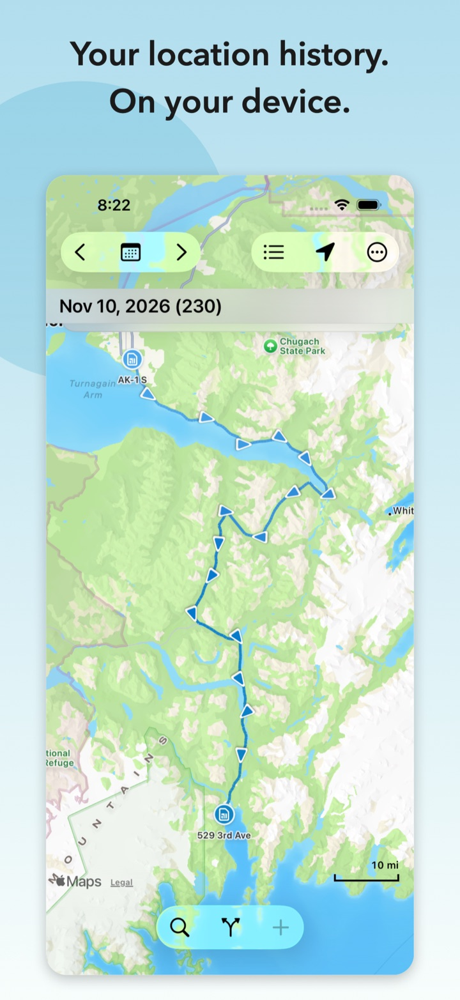
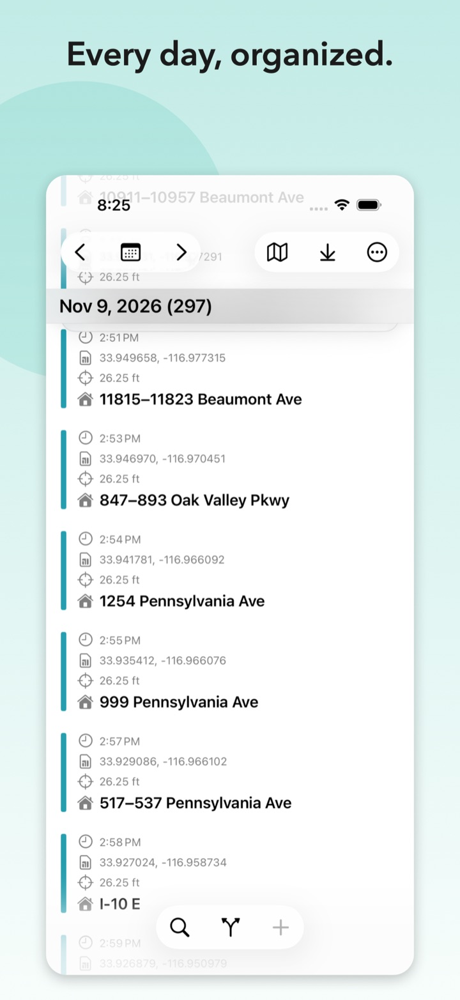
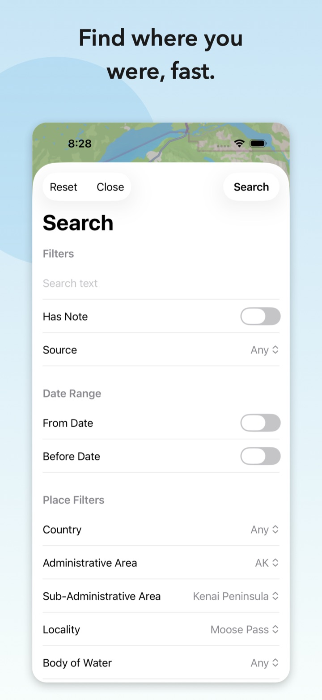
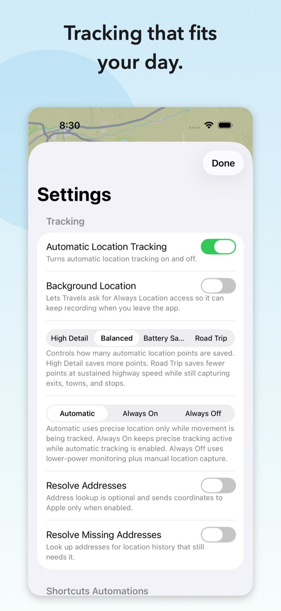

# Travels

## Your location history. On your device.

Travels is a privacy-first iPhone app for recording, searching, and revisiting your personal location history. It helps you remember where you went and when, without requiring an account or turning your movements into someone else's product.

Use Travels to answer questions such as:

- Where did we have dinner on my birthday?
- When was I last in San Francisco?
- What time did I leave home this morning?
- Which route did I take that day?

  

## Private by design

Your location history is sensitive. Travels is designed to keep it under your control.

- Location history is stored locally in the app's container on your iPhone.
- No account, advertising, analytics, subscription, or developer-operated location service is required.
- Travels does not sell your information or send your location history to the developer.
- Address lookup is optional and sends coordinates to Apple only when enabled.
- Data otherwise leaves Travels only when you export or share it, or when an enabled feature uses an Apple platform service.
- An optional device-owner authentication lock can obscure your history when Travels is not unlocked.

Read the complete [Travels Privacy Policy](https://github.com/dkrnet/travels-ios/blob/main/PRIVACY.md).

## Remember your days

Browse a day's history on a map or in a chronological list. Travels identifies likely trips and stopped locations, keeps map and list navigation connected, and uses local solar periods to give each event a time-of-day color.

Open an event to inspect its recorded details, add a note, correct how its movement or trip-endpoint status should be interpreted, resolve its address when desired, or remove it.

  

## Find the moments that matter

Search your history by text, date, source, notes, and available place information. Travels can help find a specific visit even when you remember the place but not the date.

  

## Capture locations your way

Travels supports automatic and manual location capture:

- **Automatic** Precise Location Mode balances route detail and battery use by moving between lower-power monitoring and temporary high-precision tracking.
- **Always On** keeps high-precision tracking active when maximum route fidelity matters more than battery use.
- **Always Off** keeps automatic tracking in its lower-power mode while preserving manual and Shortcuts-based capture.
- **Location Detail** presets let you choose the balance between point density and battery use.
- The **Add** Shortcuts action can capture normal, forced, non-duplicate, stopped, or moving locations through user-created automations.

  

Automatic tracking is subject to normal iOS background-execution and location-delivery behavior. Travels is a personal history tool, not a real-time safety, emergency, or remote-monitoring service.

## Bring your history with you

Your data is not locked into an online account or developer-operated service.

- Import and export standard GPX location files.
- Create location events from geotagged photos, with or without copying the photo into Travels.
- Back up and restore the local Travels database and attachments.
- Import compatible history from the original Travels app.

Exports, backups, photos, and GPX files may contain precise location history. Store and share them with the same care you would give any other sensitive personal record.

## Why Travels is free

I created Travels because I wanted a privacy-first way to keep my own location history. It is free because this is a niche app, and charging for it would add more complexity than value.

**You are not the product.** Travels has no advertising, analytics, accounts, subscriptions, or business model based on selling your location data.

## Open source

Travels is open source, so its implementation and privacy claims can be inspected by anyone.

- [Source code and documentation](https://github.com/dkrnet/travels-ios)
- [Report a problem or request a feature](https://github.com/dkrnet/travels-ios/issues)
- [Mozilla Public License 2.0](https://www.mozilla.org/MPL/2.0/)

Travels requires iOS 17 or later. Automatic history recording requires location permission, and background recording requires the corresponding iOS background-location permission.

For private support questions, email [adigitalanalog@proton.me](mailto:adigitalanalog@proton.me). Do not include precise location history, addresses, photos, GPX files, or database backups in a public issue.
